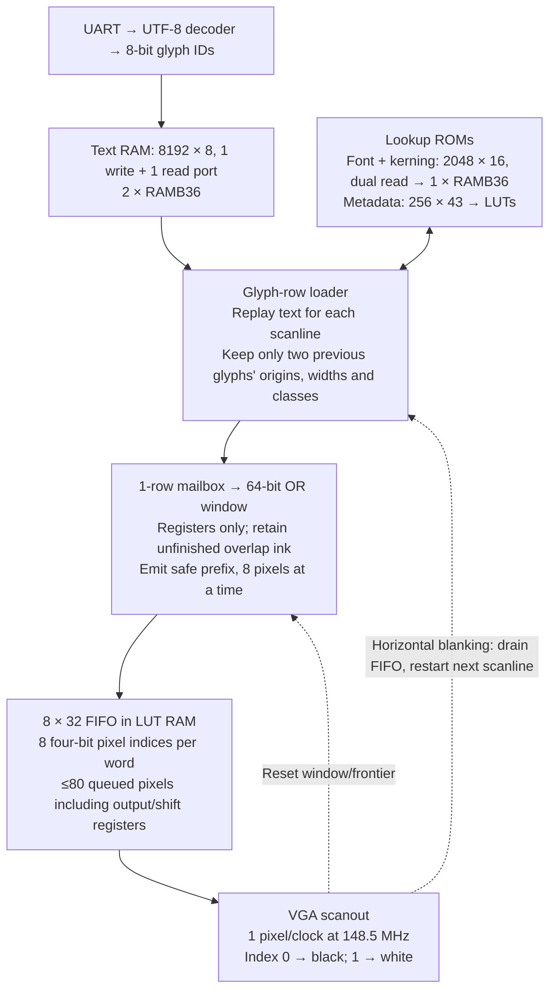

# Non-AA font renderer

**BRAM budget: 3 × RAMB36E1 = 13.5 KiB**, including text storage. Everything else uses LUTs/registers.

- **Font packing:** vertically crop glyphs; deduplicate their ≤21-bit rows. In the **same** ROM, words 0–395 hold 264 patterns packed as three little-endian bytes each; words 396–1937 hold 1,542 row IDs, one 9-bit ID per 16-bit word. Metadata holds base, top, height, width, valid, guard and two 6-bit kerning classes. Fetch `id = ROM[base + y - top] & 511`; then read both ports at `a = floor(3*id/2)` and `a+1`. Extract 21 bits from the concatenated words, shifted by `8*(id & 1)`; bit 0 is leftmost. Outside the crop, ink is zero.
- **Placement:** use the upstream spacing-4, slack-2 kerning with 29 left × 29 right classes, padded to 32×32. Each pair may widen by up to two pixels; fixed-cell pairs stay exact. Store the 1,024 four-bit adjustments in bits 15:12 of font words 1024–2047, which otherwise hold nine-bit row IDs or padding. Both history lookups share the font ROM, addressed by `1024 | (previous.left_class << 5) | current.right_class`. New origin is `max(previous.origin + previous.width + 4 - adjustment)` over the two predecessors; first glyph starts at the left margin. History resets on each scanline replay.
- **Streaming:** OR each row into the window at `origin - frontier`. Emit only whole 8-pixel groups ending at or before `origin - guard`, advancing the window/frontier only when the FIFO accepts. Current guards are zero. At newline/wrap/end, flush to screen width. No framebuffer, scanline buffer or placement cache.
- **Scheduling:** use synchronous one-cycle memory reads; time-share the font ROM between the two kerning reads, row IDs and dictionary reads. Pipeline/prefetch for six clocks per glyph; overlap loading with composition through the mailbox. Snapshot text length per frame and reread each text line for its glyph scanlines. Prefill during blanking; VGA never stalls.

Source: [renderer](../examples/hardware/vga_uart_pixels.py), [combined font ROM](../examples/hardware/font_row_rom.py), [ROM constants and metadata bit layout](../examples/hardware/red2_row_data.py), [table generator](../scripts/generate_uart_font.py). Final pin-constrained routing reaches **158.68 MHz** for the 148.5 MHz pixel-clock target. The six-frame Unicode/wrapping/backspace HDL capture matches the independent column renderer exactly; 29 font/UART tests pass in the pinned toolchain. BRAM allocation checked against the synthesized `build/basys3/vga_uart_1920_1080_demo/pipelinec/top/top.json`.
